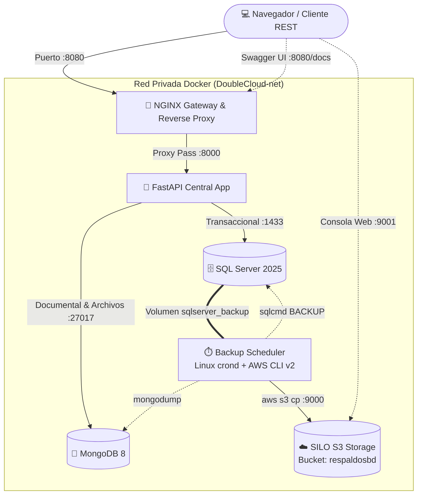

# ☁️ CampusCloud / DoubleCloud — Infraestructura de Base de Datos en la Nube

> **Universidad Tecnológica de Tula-Tepeji (UTTT)**  
> **Asignatura:** Base de Datos en la Nube  
> **Equipo 1:** Héctor, Cristian, Elan  
> **Motores Asignados:** **Microsoft SQL Server 2025 Developer** & **MongoDB 8 Community**  

---

## 📌 1. Descripción General del Proyecto

**CampusCloud** es una plataforma de servicios de datos en la nube orquestada mediante **Docker Compose**. Implementa una arquitectura desacoplada y de alta disponibilidad con persistencia políglota (relacional y NoSQL), gateway perimetral con proxy inverso, almacenamiento de objetos compatible con Amazon S3 y un agente de respaldos automatizados con tareas programadas (`crond`).



---

## 🏗️ 2. Directorio de Servicios y Puertos

| Servicio | Nombre Contenedor | Imagen Base | Puerto Host : Contenedor | Propósito y Rol |
| :--- | :--- | :--- | :---: | :--- |
| **NGINX** | `DoubleCloud-nginx` | `nginx:alpine` | `8080:80` | Gateway único, proxy inverso y buffering 100M |
| **API Central** | `DoubleCloud-api` | Python 3.11 Slim | `8000:8000` | FastAPI, endpoints CRUD, Dashboard y visor |
| **SQL Server** | `DoubleCloud-sqlserver` | `mssql/server:2025-latest` | `1434:1433` | Motor relacional (Usuarios, Roles, Auth) |
| **MongoDB** | `DoubleCloud-mongodb` | `mongo:8` | `27018:27017` | Motor NoSQL (Documentos y metadata de archivos) |
| **SILO (S3)** | `DoubleCloud-silo` | `pgsty/silo:latest` | `9000:9000`<br>`9001:9001` | Almacenamiento de objetos S3 (API y Consola Web) |
| **Scheduler**| `DoubleCloud-backup-scheduler` | Oracle Linux 9 / RHEL9 | *Red interna* | Cron dominical 02:00 CST y sincronizador a S3 |

---

## 🔑 3. Credenciales Predeterminadas para Pruebas

| Servicio | Usuario | Contraseña / Clave | Base de Datos / Bucket |
| :--- | :--- | :--- | :--- |
| **SQL Server** | `sa` | `SqlServer2025!Campus` | `CampusCloudDB` |
| **MongoDB** | `admin` | `Mongo123` | `campuscloud` (auth: `admin`) |
| **SILO (S3)** | `minioadmin` | `CampusCloud2025!` | Bucket: `respaldosbd` |

---

## 🚀 4. Guía de Despliegue Rápido (1 Solo Paso)

### Prerrequisitos
- Docker Desktop con WSL2 habilitado (Windows / Linux / macOS).
- Git.

### Pasos de Despliegue
1. Clonar el repositorio:
   ```bash
   git clone https://github.com/Inu41123/ProyectoDBN.git
   cd ProyectoDBN
   ```

2. Si no existe el archivo `.env`, crear una copia a partir de `.env.example`:
   ```bash
   cp .env.example .env
   ```

3. Construir y levantar todos los servicios en segundo plano:
   ```bash
   docker compose up -d --build
   ```

4. Verificar que los 6 contenedores estén arriba:
   ```bash
   docker compose ps
   ```

---

## 🌐 5. Puntos de Entrada y Accesos Web

Una vez levantada la infraestructura, ingresar mediante el navegador:
- **Dashboard Web Principal (Frontend):** [http://localhost:8080/](http://localhost:8080/)
- **Documentación Swagger UI (OpenAPI):** [http://localhost:8080/docs](http://localhost:8080/docs)
- **Documentación ReDoc:** [http://localhost:8080/redoc](http://localhost:8080/redoc)
- **Consola Web de SILO S3:** [http://localhost:9001/](http://localhost:9001/)

---

## ⏱️ 6. Pruebas y Operación del Sistema de Respaldos

El agente `backup-scheduler` ejecuta automáticamente los respaldos todos los **domingos a las 02:00 AM CST** mediante `crond`.

### Ejecución Manual Inmediata:
Para generar y subir un respaldo en este instante a SILO S3:
```bash
docker exec DoubleCloud-backup-scheduler sh /scripts/backup-semanal.sh
```

### Listar los Respaldos Almacenados en S3:
```bash
docker exec DoubleCloud-backup-scheduler aws --endpoint-url http://minio:9000 s3 ls s3://respaldosbd/ --recursive --human-readable
```

---

## 📚 7. Documentación Técnica Detallada por Fases

El proyecto cuenta con documentación modular y detallada para cada etapa de la evaluación:

- 📋 [**Checklist Global del Proyecto**](docs/CHECKLIST_GLOBAL.md): Seguimiento de entregables y rúbrica.
- 🐳 [**Fase 1: Infraestructura y Orquestación Docker**](docs/FASE1_INFRAESTRUCTURA.md): Configuración de red, volúmenes y persistencia.
- ⚡ [**Fase 2: Aplicación Web y Endpoints CRUD**](docs/FASE2_CRUD_API.md): Modelos Pydantic, motor FastAPI, Bootstrap 5 y upload de archivos.
- 🔀 [**Fase 3: Gateway NGINX y Swagger**](docs/FASE3_NGINX_PROXY.md): Reglas de ruteo, límites de carga (100M) y proxy inverso.
- ⏱️ [**Fase 4: Agente Backup-Scheduler**](docs/FASE4_SCHEDULER_INFRA.md): Dockerfile RHEL9, clientes `sqlcmd`/`mongodump` y crond.
- ☁️ [**Fase 5: Pipeline S3 y Disaster Recovery**](docs/FASE5_RESPALDOS_S3.md): Sincronización a SILO, checksums y restauración.
- 🎓 [**Fase 6: Guía Maestra de Exposición para el Equipo**](docs/FASE6_GUIA_EXPOSICION.md): Distribución de roles (Héctor, Cristian, Elan), comandos seguros de terminal y respuestas a preguntas trampa.

---

## 👥 8. Integrantes del Equipo 1
- **Héctor** — *Líder de Infraestructura & Proxy Gateway*
- **Cristian** — *Arquitectura de Datos & Backend API*
- **Elan** — *Ingeniero de Respaldos & Almacenamiento Cloud*
